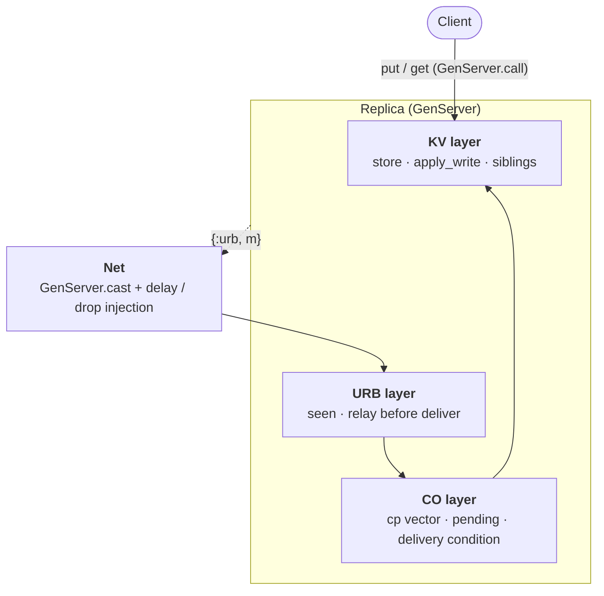
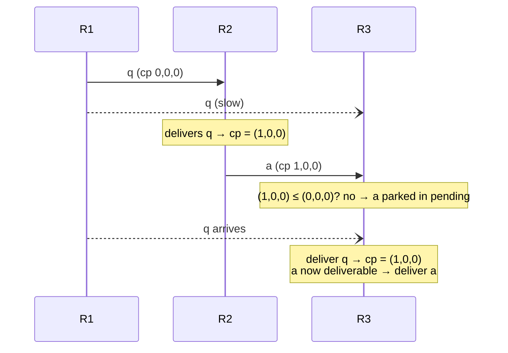

# Leaderless Causal KV Store

> A fully replicated, leaderless key-value store in Elixir with **causal consistency**, built on **Causal-Order Uniform Reliable Broadcast (CO-URB)** and vector clocks, with **sibling** versions for concurrent writes.

Every replica accepts writes. Writes are broadcast to all other replicas, delivered in **causal order**, and concurrent writes to the same key are **kept side by side** instead of being silently overwritten. The design is checked two ways: by **distributed tests with fault injection** (delays, lost messages, crashes) and by a **TLA+ specification** model-checked with TLC.

Lab 2 of the *Distributed Systems* course (Vilnius University, 2026).

---

## Table of contents

- [Why](#why)
- [System model](#system-model)
- [Architecture](#architecture)
- [How it works](#how-it-works)
  - [Vectors](#vectors)
  - [Write path](#write-path)
  - [Receive path](#receive-path)
  - [Siblings and merge](#siblings-and-merge)
- [Algorithms](#algorithms)
- [Usage](#usage)
- [Project structure](#project-structure)
- [Testing](#testing)
- [Formal specification (TLA+)](#formal-specification-tla)
- [Limitations](#limitations)
- [References](#references)

---

## Why

In a multi-leader or leaderless setup, a naive "send the write to everyone" approach breaks in two ways:

| Problem | Example | Fixed by |
|---|---|---|
| **Divergence after a crash** | the writer crashes after sending to R2 but before R3: R3 never gets the write | **URB** (relay before deliver) |
| **Causality violations** | R3 sees the *answer* before the *question* it replies to (DDIA fig. 6-8) | **CO** (wait until the causal past is delivered) |
| **Lost updates** | two clients write the same key concurrently, one value disappears (LWW) | **Siblings** (keep concurrent versions) |

This project implements all three fixes and includes the naive version as a **witness**, so every guarantee can be shown failing without the corresponding algorithm.

## System model

| Assumption | Value |
|---|---|
| Processes | `n = 3` replicas, fixed and known |
| Failures | **crash-stop** (a crashed replica never comes back) |
| Channels | **reliable, asynchronous** — `CAMP_{n,t}[∅]` |
| Clients | **sticky sessions** (a client always talks to the same replica) |
| Consistency | **causal**; available under partitions (AP in CAP terms) |

No consensus is needed: total-order broadcast is impossible in this model (FLP), but causal broadcast is not.

## Architecture

Each replica is a single `GenServer` that contains three logical layers.



| Layer | Question it answers | If "no" |
|---|---|---|
| **URB** | Have I already received this message? | relay it to the others, then pass it up |
| **CO** | Have I delivered everything this message depends on? | park it in `pending` |
| **KV** | Does this version supersede a stored one? | keep both (siblings) |

## How it works

### Vectors

A vector is a map with one counter per replica, e.g. `%{1 => 2, 2 => 1, 3 => 0}`, written `(2,1,0)` below. A **single vector mechanism** is used both for causal delivery and for version comparison.

| Name | Meaning | Lifetime |
|---|---|---|
| `state.cp` | what this replica has **delivered**: `cp[k]` = number of writes from replica *k* applied here | grows by 1 per delivery |
| `m.cp` | the writer's `cp` **just before** the write — the causal past of the message | frozen |
| `V(m)` | the **version tag** stored with the value: `m.cp` plus 1 at the writer's index | frozen |

Comparisons (`CausalKv.Store`):

| Function | Definition | Meaning |
|---|---|---|
| `leq?(a, b)` | ∀k, a[k] ≤ b[k] | *b* knows everything *a* knows |
| `lt?(a, b)` | a ≤ b and a ≠ b | *a* is strictly in the past of *b* |
| `concurrent?(a, b)` | neither a ≤ b nor b ≤ a | neither has seen the other |

### Write path

`put(:x, "a")` on replica R1 whose `cp = (0,0,0)`:

1. Build the message `m = %{id: {1, 1}, sender: 1, cp: (0,0,0), key: :x, value: "a"}`.
2. Add `m.id` to `seen`.
3. Send `{:urb, m}` to the other replicas (**before** delivering — this is what makes the broadcast uniform).
4. Deliver locally: tag `V(m) = (1,0,0)`, store `x → [{"a", (1,0,0)}]`, `cp` becomes `(1,0,0)`.
5. Reply `:ok`.

The local delivery needs no waiting: `m.cp` equals the current `cp`, so the delivery condition holds immediately. This replaces the `wait(done)` of the textbook algorithm.

### Receive path

When `{:urb, m}` arrives at a replica in `:co` mode:

```
already in seen?            → ignore                       (URB-integrity)
otherwise                   → add to seen
                              relay m to the others        (URB-termination-2)
                              add m to pending
                              while some m' in pending satisfies m'.cp ≤ cp:
                                  deliver m'               (CO delivery condition)
```

**Example — the answer arrives before the question.** R1 writes `q` (`m.cp = (0,0,0)`), R2 delivers it and writes `a` (`m.cp = (1,0,0)`). On R3, `a` arrives first:



In `:naive` mode, R3 would deliver `a` immediately and show an answer without its question.

### Siblings and merge

`apply_write(versions, {value, vec})` keeps every stored version **not strictly older** than the new one, then adds the new one:

| Stored | Incoming | Result | Why |
|---|---|---|---|
| `[{"a", (1,0,0)}]` | `{"b", (1,1,0)}` | `[{"b", (1,1,0)}]` | (1,0,0) < (1,1,0): overwrite |
| `[{"b", (1,1,0)}]` | `{"c", (0,0,1)}` | `[{"c", …}, {"b", …}]` | concurrent: **siblings** |
| `[{"c", (0,0,1)}, {"b", (1,1,0)}]` | `{"bc", (2,1,1)}` | `[{"bc", (2,1,1)}]` | dominates both: **merge** |

`get(:x)` returns all sibling values (`["c", "b"]`). The client resolves the conflict by writing a new value after reading them; that write dominates every sibling and replaces them on all replicas. There is no special merge code.

Because a write is only delivered after its whole causal past, the store of each replica depends only on the **set** of delivered writes, not on their order: replicas that delivered the same writes have the same store (**convergence**).

## Algorithms

Formulations follow Raynal (2018) as presented in the course.

**URB — Uniform Reliable Broadcast**

| Property | Statement | Kind |
|---|---|---|
| URB-validity | if a process urb-delivers *m*, then *m* was urb-broadcast by *m.sender* | safety |
| URB-integrity | a process urb-delivers *m* at most once | safety |
| URB-termination-1 | if a non-faulty process urb-broadcasts *m*, it urb-delivers *m* | liveness |
| URB-termination-2 | if a process urb-delivers *m*, every non-faulty process urb-delivers *m* | liveness |

**CO-URB** adds:

| Property | Statement | Kind |
|---|---|---|
| CO-URB message delivery | if *m* causally precedes *m'*, no process co-delivers *m'* unless it previously co-delivered *m* | safety |

Delivery condition: `DC(m) ⟺ ∀k, cp[k] ≥ m.cp[k]`, implemented as `Store.leq?(m.cp, state.cp)`.

| Course pseudocode | Code |
|---|---|
| `causalPast_i` | `state.cp` |
| `msgs_i` | `state.pending` |
| first reception of *m* | `MapSet.member?(state.seen, m.id)` |
| forward to all, then deliver | `send_others/2`, then `try_deliver/1` |
| `while ∃ m' ∈ msgs_i : DC_i(m')` | recursive `try_deliver/1` |
| `CO_Deliver(m)` | `deliver/2` (applies the write to the store) |
| `wait(done_i)` | not needed: own message delivered synchronously in `put` |
| BE broadcast (counterexample) | `mode: :naive` |

## Usage

Requirements: Elixir ≥ 1.15, Erlang/OTP ≥ 26.

```bash
git clone https://github.com/MatthieuGHS/leaderless-causal-kv-store.git
cd leaderless-causal-kv-store
mix test
```

Interactive session:

```elixir
iex -S mix

alias CausalKv.Replica
{:ok, r1} = Replica.start_link(id: 1)
{:ok, r2} = Replica.start_link(id: 2)
{:ok, r3} = Replica.start_link(id: 3)

Replica.put(r1, :x, "hello")
Replica.get(r3, :x)               #=> ["hello"]

:sys.get_state(r3)                # inspect cp, store, log, pending...
```

Options for `start_link/1`:

| Option | Values | Default |
|---|---|---|
| `:id` | `1`, `2` or `3` | required |
| `:mode` | `:co` (CO-URB) or `:naive` (best-effort broadcast, the witness) | `:co` |

Replicas register as `:replica_1`, `:replica_2`, `:replica_3`.

## Project structure

```
lib/causal_kv/
  store.ex        vector comparisons, version tag, write rule (pure functions)
  replica.ex      one replica: GenServer with URB, CO and KV layers
  net.ex          transport between replicas, with fault injection for tests
test/
  store_test.exs      unit tests for vectors and apply_write
  replica_test.exs    single replica, propagation, Net, delivery log
  scenarios_test.exs  distributed scenarios: crash, causal order, siblings
spec/
  CausalKV.tla        TLA+ specification
  CausalKV.cfg        TLC model, CO-URB mode
  MC_naive.cfg        TLC model, naive mode (expected to fail)
```

## Testing

All messages between replicas go through `CausalKv.Net`, so tests can control the network:

```elixir
Net.set(1, 3, 300)      # messages from R1 to R3 are delayed by 300 ms
Net.set(1, 3, :drop)    # messages from R1 to R3 are never sent (sender crashed mid-broadcast)
Net.clear()             # back to immediate delivery
```

The distributed scenarios run each situation in both modes, showing the property **fail without the algorithm** and **hold with it**:

| Scenario | `:naive` | `:co` | Property |
|---|---|---|---|
| R1 writes, crashes before sending to R3 | R3 never gets the write | R2 relays, R3 gets it | URB-termination-2 |
| Answer reaches R3 before the question | R3 shows the answer alone; log `[{2,1}, {1,1}]` | answer waits in `pending`; log `[{1,1}, {2,1}]` | CO-URB delivery |
| R1 and R2 write `:x` concurrently, then a client merges | — | siblings `["a", "b"]` everywhere, then `["ab"]` everywhere | siblings, convergence |

```bash
mix test                                  # 28 tests
mix test --repeat-until-failure 20        # check timing-based tests are stable
```

## Formal specification (TLA+)

`spec/CausalKV.tla` models the system at the **URB abstraction level**: a set `sent` holds every broadcast message and any live replica may deliver one when the delivery condition allows (the relay mechanism itself is covered by the Elixir tests).

| Spec | Code |
|---|---|
| `Leq`, `Lt`, `V`, `ApplyWrite` | `Store.leq?`, `lt?`, `version`, `apply_write` |
| `DC(i, m)` | `Store.leq?(m.cp, state.cp)` |
| `Put(i, k, v)` | `handle_call({:put, …})` |
| `Deliver(i, m)` | `handle_cast` + `try_deliver` |
| `Crash(i)` | replica crash; in naive mode, some of its sends are lost |
| `dlv[i]` | `state.log` |

Checked properties:

| Property | Statement | Kind |
|---|---|---|
| `TypeOK` | variables have the expected types | safety |
| `Validity` | only broadcast messages are delivered | safety |
| `Integrity` | each message is delivered at most once | safety |
| `CausalDelivery` | if V(m) < V(m'), *m* is delivered before *m'* | safety |
| `StoreInv` | each store holds exactly the maximal versions of the delivered writes | safety |
| `Convergence` | same delivered writes ⇒ same store | safety |
| `AllDelivered` | eventually every live replica has delivered every broadcast message | liveness (weak fairness) |

Model: 3 replicas, 2 keys, 2 values, at most 3 writes and 1 crash.

| Config | Result |
|---|---|
| `CausalKV.cfg` (`co`) | **No error found** — 331,908 distinct states explored |
| `MC_naive.cfg` (`naive`) | **`CausalDelivery` violated** — 4-state counterexample (a replica delivers R1's 2nd write before its 1st). Checked one at a time, `Convergence` and `AllDelivered` are violated too. |

Run with the [TLA+ VS Code extension](https://marketplace.visualstudio.com/items?itemName=tlaplus.vscode-ide) ("TLA+: Check model with TLC"), or:

```bash
cd spec
java -jar tla2tools.jar -workers auto -config CausalKV.cfg CausalKV.tla
java -jar tla2tools.jar -workers auto -config MC_naive.cfg CausalKV.tla
```

## Limitations

- **Reliable channels are an idealisation.** Erlang keeps per-pair FIFO order but may drop messages when a distribution connection goes down. Over fair-lossy channels the algorithm would need retransmissions and acknowledgements.
- **Fixed membership.** The replica set `[1, 2, 3]` is hard-coded; no join, leave or recovery.
- **Crash-stop only.** State is in memory; a restarted replica would forget what it delivered (crash-recovery would require persisting before delivering).
- **No garbage collection.** `seen` and `log` grow without bound.
- **Causal, not linearizable.** Two clients on different replicas can observe different values for a while; conflicts are surfaced as siblings, not prevented.

## References

- M. Raynal, *Fault-Tolerant Message-Passing Distributed Systems: An Algorithmic Approach*, Springer, 2018 — URB and CO-URB algorithms.
- M. Kleppmann, *Designing Data-Intensive Applications*, 2nd ed. — multi-leader replication, concurrent writes, version vectors and siblings (ch. 6).
- L. Lamport, *Specifying Systems*, Addison-Wesley, 2002 — TLA+ and TLC.
- K. Petrauskas, *Distributed Systems* lecture notes, Vilnius University, 2026.